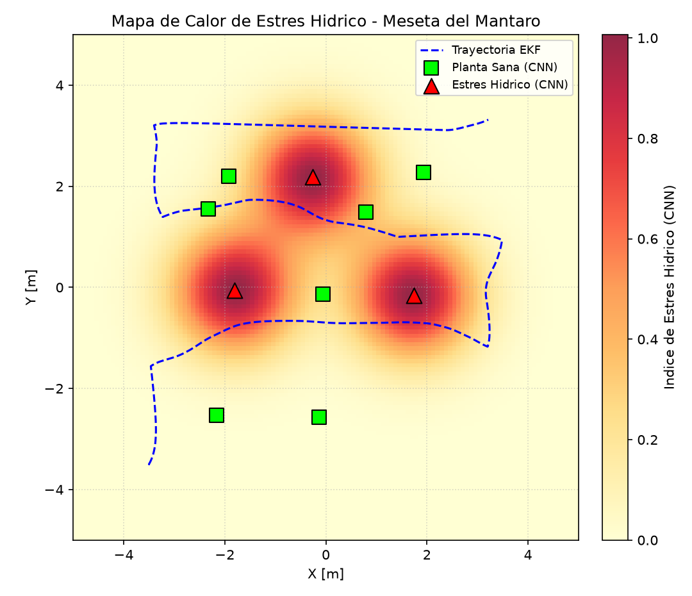
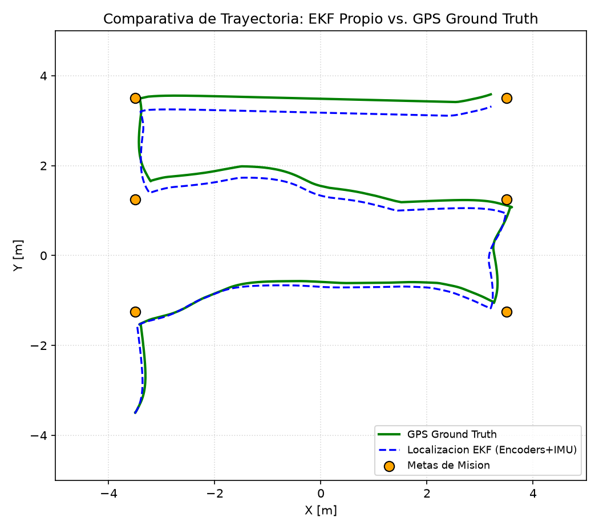

# Rover Explorador Agricola Autonomo 4x4 (Webots R2025a)

Sistema robotico movil autonomo simulado en **Webots R2025a** para el monitoreo de cultivos agricolas (deteccion de estres hidrico en la meseta del Mantaro), desarrollado como Proyecto Final de **Robotica Avanzada**.

## Arquitectura Modular (5 Modulos Separados)

1. **percepcion.py**: Interfaz de sensores (LiDAR 360, camara RGB, IMU, 4 encoders, GPS solo ground truth) y cinematica skid-steer 4x4.
2. **localizacion.py**: Filtro de Kalman Extendido (EKF) propio fusionando encoders e IMU (0 % GPS para navegacion).
3. **planificacion.py**: Mapa de Ocupacion 2D (estatico + capa dinamica por LiDAR), algoritmo A* propio con replanificacion y Campos Potenciales.
4. **vision.py**: Pipeline OpenCV (suavizado + segmentacion HSV) + Red Neuronal Convolucional (**CultivoCNN** en PyTorch) con exportacion CSV/JSON y mapa de calor.
5. **mision.py**: Orquestacion autonoma de la mision de inspeccion de 6 metas y generacion de graficas.

## Estructura del Repositorio

``` text
.
├── protos/
│   └── RoverAgricola.proto
├── worlds/
│   └── campo_agricola.wbt
├── controllers/
│   ├── obstaculo_movil/
│   │   └── obstaculo_movil.py
│   └── rover_controller/
│       ├── rover_controller.py
│       ├── percepcion.py
│       ├── localizacion.py
│       ├── planificacion.py
│       ├── vision.py
│       ├── mision.py
│       ├── entrenar_cnn.py
│       └── modelo_cultivos_cnn.pth
├── resultados/
│   ├── detecciones.csv
│   ├── detecciones.json
│   ├── localizacion_log.csv
│   ├── metricas_cnn.json
│   ├── mapa_calor_estres.png
│   ├── trayectoria_ekf_vs_gps.png
│   └── captura_vision_1..6.png
├── requirements.txt
└── README.md
```

## Requisitos e Instalacion

- **Simulador:** Webots **R2025a**
- **Python:** Python **3.12** (configurado en *Tools > Preferences > General > Python command*)

``` bash
pip install opencv-python numpy matplotlib
pip install torch --index-url [https://download.pytorch.org/whl/cpu](https://download.pytorch.org/whl/cpu)
```

*(Opcional) Reentrenar el modelo CNN:*
``` bash
python controllers/rover_controller/entrenar_cnn.py
```

## Ejecucion en Webots R2025a

1. Abrir **Webots R2025a**.
2. Ir a **File > Open World...** y abrir **worlds/campo_agricola.wbt**.
3. Presionar **Reset** y luego **Play**. El rover recorrera las 6 metas (~77 s simulados) y actualizara automaticamente **resultados/**.

## Resultados Experimentales

| Metrica | Valor Obtenido |
| :--- | :--- |
| Tiempo total de mision (6/6 metas) | 76.9 s |
| Error EKF promedio vs. GPS ground truth | 0.189 m |
| Error EKF maximo vs. GPS ground truth | 0.311 m |
| Plantas detectadas por CultivoCNN | 10 (7 sanas / 3 estres hidrico) |
| Confianza en detecciones validas | 93.8 % - 100.0 % |
| Uso de GPS o Supervisor para navegacion | Ninguno (0 %) |

| Mapa de Calor de Estres Hidrico | Trayectoria EKF vs. GPS Ground Truth |
| :---: | :---: |
|  |  |
